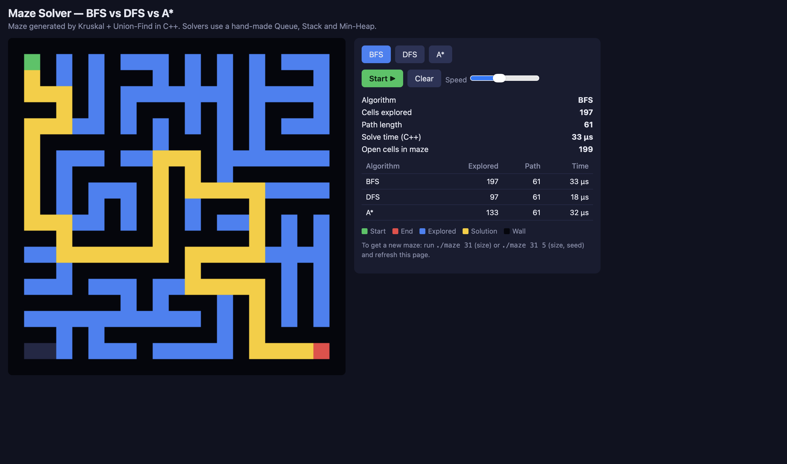
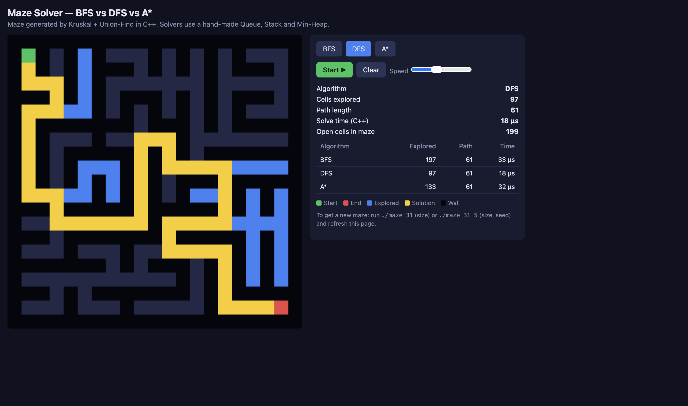
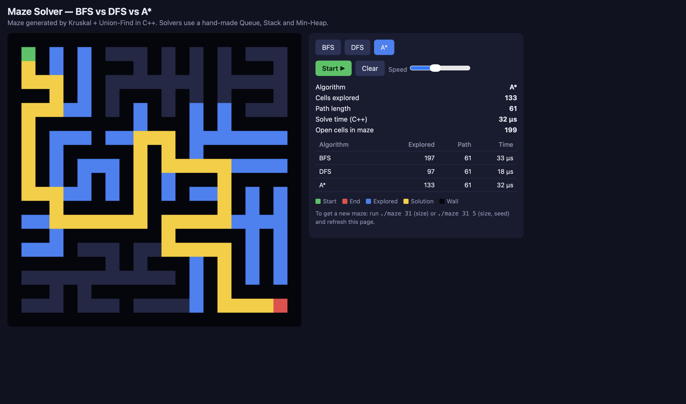

# Kruskal Maze Generator & Multi-Algorithm Pathfinding Visualizer (ADS Project)

A C++17 implementation of maze generation and pathfinding algorithms using **custom data structures written from scratch** (zero STL containers like `std::queue`, `std::stack`, or `std::priority_queue`), paired with an interactive HTML5 Canvas visualizer.

## Data Structures Implemented from Scratch (`maze.cpp`)
1. **Disjoint Set Union (Union-Find)** with Path Compression & Union by Rank — used in **Randomized Kruskal's Algorithm** to generate a cycle-free perfect maze.
2. **Queue (FIFO)** — array-based queue used for **Breadth-First Search (BFS)**.
3. **Stack (LIFO)** — array-based stack used for **Depth-First Search (DFS)**.
4. **Min-Heap (Binary Heap)** — array-based priority queue ordered by $f = g + h$ (Manhattan distance heuristic) used for **A\* Search**.

## Visualizations

| BFS | DFS | A* |
| :---: | :---: | :---: |
|  |  |  |

## Build & Run
```bash
g++ -O2 -std=c++17 -o maze maze.cpp
./maze 21 7
# Open viewer.html in any browser to view the step-by-step animation
```
